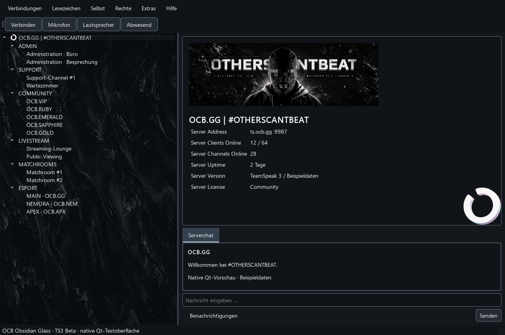

# OCB.GG Obsidian Glass — TeamSpeak 3

Eigenständiges OCB-Client-Theme für TeamSpeak 3, Version **1.0.0-beta.1**.
Anthrazit, Silber, durchgehende Glastextur im Serverbaum und Original-OCB-Banner.
Menüs, Einstellungen, Chat, Tabellen, Eingaben und Statusleiste erhalten passende Farben.

## Download und Installation
1. [OCB-Obsidian-Glass-TS3-1.0.0-beta.1.ts3_style](downloads/OCB-Obsidian-Glass-TS3-1.0.0-beta.1.ts3_style) herunterladen (bei GitHub **Download raw file**).
2. Datei doppelklicken und im TeamSpeak-Paketinstaller installieren.
3. In TS3 **Extras → Optionen → Design** das Theme **ocb_obsidian** wählen. Falls angeboten, den Stil **Fusion** wählen; dieser ist die geprüfte Qt-Basis.
4. Übernehmen und TS3 gegebenenfalls neu starten.

Falls keine Dateizuordnung existiert: Rechtsklick → Öffnen mit → `package_inst.exe` aus dem TeamSpeak-3-Installationsordner.
Alternativ den Inhalt von `styles/` nach `%APPDATA%/TS3Client/styles/` kopieren. Bereits vorhandene Dateien dieses Themes vorher sichern.
Linux: `~/.ts3client/styles/`; macOS: `~/Library/Application Support/TeamSpeak 3/styles/`.
Deinstallation: zuerst Standardtheme wählen, danach `ocb_obsidian.qss`, `ocb_obsidian_chat.qss` und den Ordner `ocb_obsidian` aus dem Benutzer-Styles-Verzeichnis entfernen.

## Grafik und Grenzen
- Glastextur: 3840 × 2160, aus 1672 × 941 hochskaliert; keine native 4K-Detailaufnahme.
- Originalbanner: 2172 × 724, unverändert. Darstellung im Server-Infobereich: 480 × 160; sehr schmale Infobereiche benötigen mehr Platz.
- Ein Hintergrund über den gesamten Kanalbaum, keine wiederholten Bildstreifen je Kanal. Qt passt die Textur an die Fläche an; extreme Seitenverhältnisse können sie verzerren.
- Original-Bigcircle im Infobereich. Vorhandene Server-, Gruppen-, Mikrofon- und Statusicons bleiben erhalten. Dieses Paket ersetzt keine globalen Servericons.
- Keine Plugins, Skripte oder extern geladenen Ressourcen. Das Theme fügt keine Bildschirmfreigabe oder andere Clientfunktionen hinzu.
- Aufbau anhand der installierten TS3-3.5.6-Dateien geprüft. Native Qt-5-Testoberfläche geprüft; noch kein vollständiger Funktionstest im laufenden TS3-Client. Daher ausdrücklich Beta. Andere Versionen und Betriebssysteme sind nicht live geprüft.

## Vorschau

Die Vorschau verwendet die echten QSS-Dateien in einer nativen Qt-5-Testoberfläche. Serverdaten sind Beispieldaten.

## Weitere OCB-Themes
[TeamSpeak 6 Theme](https://github.com/ir0CKx/OCB-TS6-THEME) — eigenes Paket, separat installieren.

## Nutzung
Kostenlose Nutzung gemäß [Nutzungsbedingungen](LICENSE.txt). Kein Weiterverkauf, keine separate Verwendung des Logos ohne Erlaubnis. Community-Projekt von OCB.GG, kein offizielles TeamSpeak-Produkt.

## Formatreferenzen
Paketstruktur: [Improved Default Theme](https://github.com/svenpaulsen/ts3client-improved-theme). QSS wurde eigenständig für OCB geschrieben; kein fremder Theme-Code übernommen.
